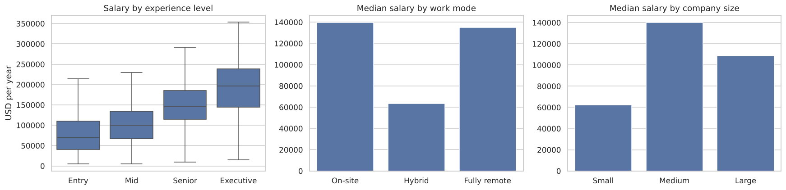
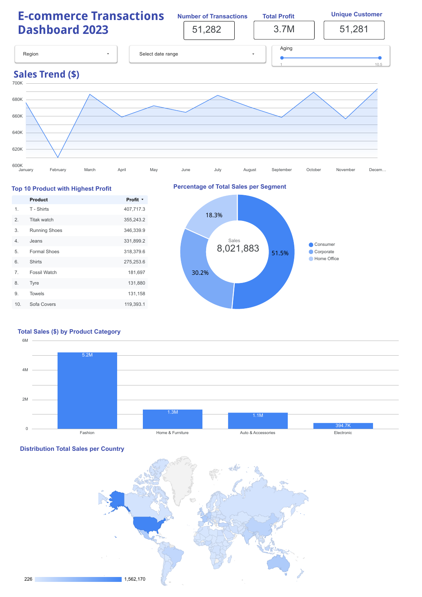
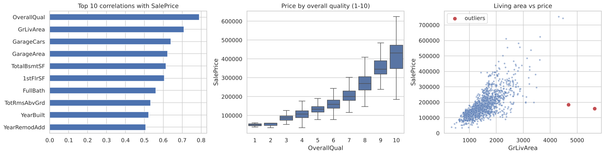

# Data Science Bootcamp Projects

Shorter analysis and modelling projects from the Digital Skola Data Science Bootcamp (2026), rebuilt as clean, executed notebooks with business-focused findings.

## Projects in this repo

### 1. [Data Science Salaries: what pays and where?](data_science_salaries.ipynb)
pandas wrangling and EDA on 3,755 salary records (2020–2023).
* The median salary roughly **doubles from entry level (USD 70k) to senior (USD 146k)**.
* **Fully remote roles pay about the same as on-site roles** at the median (USD 135k vs 140k). Hybrid roles pay less.
* The share of fully remote roles fell from **53% in 2022 to 33% in 2023**.

### 2. [E-commerce sales and profit analysis](ecommerce_sales_analysis.ipynb)
KPI, category, region, shipping and discount analysis on 51,282 order lines (2023).
* **Fashion brings 65% of revenue** at the best margin (47.7%).
* **Discounts give away margin without adding volume.** Quantity stays at about 3 units per order at every discount level, while the margin drops from 50% to 41%.
* Revenue is steady through the year (the best month is only about 14% above the weakest).

My original *Alchemist Project* deliverable was this Looker Studio dashboard on the same data. The notebook goes one step further with margin, discount and shipping analysis:

### 3. [House price prediction (Ames, Iowa)](house_price_prediction.ipynb)
Regression with data cleaning, feature engineering and model comparison on 1,460 home sales (Kaggle *House Prices*).
* **Quality and size set the price.** The median home sells for $133k at quality 5 and $270k at quality 8. An engineered *total square footage* feature has a 0.83 correlation with log price.
* **Lasso regression gives the best cross-validated error** (RMSE 0.110 on log price, about 11.7% typical error). It beat ridge, gradient boosting, random forest and a blend.
* Predictions for the 1,459 unpriced test homes are saved in `data/house_prices_predictions.csv`.

## Featured projects (separate repos)

| Project | What it shows |
| --- | --- |
| [Flight Price Prediction](https://github.com/mirsyaddzulfaqor-tech/flight-price-prediction) | Regression (R² 0.985), booking-window insight, Streamlit app. Bootcamp final project |
| [Customer Churn Prediction](https://github.com/mirsyaddzulfaqor-tech/customer-churn-prediction) | Classification with imbalance handling; the top 20% of the ranking reaches 50% of churners |
| [Customer Segmentation](https://github.com/mirsyaddzulfaqor-tech/customer-segmentation) | K-Means clustering into 4 marketing personas |
| [Customer Segmentation & Product Recommendation](https://github.com/mirsyaddzulfaqor-tech/customer-segmentation-recommendation) | RFM + K-Means segments on 540k retail transactions; recommender tested on future purchases (44% hit rate vs 32% bestseller baseline) |
| [Donor Reactivation System](https://github.com/mirsyaddzulfaqor-tech/donor-reactivation-demo) | RFM + ML priority queue, live Streamlit and Looker Studio demo |

## Run

`pip install -r requirements.txt`, then open any notebook. `python build_notebooks.py` and `python build_house_prices.py` re-execute the notebooks from scratch.

Data: public teaching datasets (`data/`).

---
Muhammad Irsyad Dzulfaqor · [LinkedIn](https://www.linkedin.com/in/mirsyaddzulfaqor/) · [GitHub](https://github.com/mirsyaddzulfaqor-tech)
